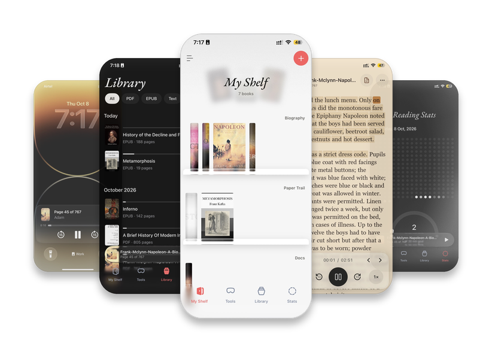

# Listen-here-ios

**A free, open-source alternative to paid reading apps like Speechify and ElevenLabs, running entirely on your iPhone.**

Import a PDF or EPUB and press play: a natural-sounding voice reads it to you and each word lights up as it's spoken. Everything runs on-device on the Apple Neural Engine, so no text leaves your phone, there's no account, and it works in airplane mode.

## Screenshots

<p align="center">
  
</p>

<p align="center"><sub>Lock Screen · Library · <b>My Shelf</b> · Read Along · Reading Stats</sub></p>

## Why not Speechify or ElevenLabs?

They're great apps, but they're paid subscriptions, they need an account, and they send your text to their servers to generate speech. This app takes a different approach:

| | **voice-app-ios** | Typical paid TTS reader |
|---|---|---|
| Price | Free, forever | Monthly subscription |
| Where speech is generated | On your iPhone | In the cloud |
| Your books leave your device | Never | Uploaded for processing |
| Works offline | ✅ | Limited or no |
| Account required | No | Yes |
| Listening limits | None | Often capped by plan |
| Source code | Open (MIT) | Closed |

## Project structure

The app lives at `local-tts/native-ios/` — a standalone Xcode project generated by [XcodeGen](https://github.com/yonaskolb/XcodeGen) from `project.yml`. **Never hand-edit the `.xcodeproj`** — edit `project.yml` and run `xcodegen generate`.

```
local-tts/native-ios/
  Sources/            # app code (MVVM + Services, feature-first folders)
  CustomKokoroModel/   # gitignored — bundled Kokoro-ANE model + voice packs
  VoicePreviews/        # bundled voice-preview audio clips
  project.yml           # source of truth for the Xcode project
```

See [`CLAUDE.md`](CLAUDE.md) for the architecture conventions and current file tree, [`docs/adr/`](docs/adr/) for the reasoning behind non-obvious decisions, and [`CHANGELOG.md`](CHANGELOG.md) for what shipped in each version.

## Building

```bash
cd local-tts/native-ios
xcodegen generate
open KokoroAneTest.xcodeproj
```

Requires Xcode with an iOS 17+ simulator or device. `CustomKokoroModel/` is gitignored (large, regeneratable) — see [`docs/adr/0002-custom-kokoro-model-bundle.md`](docs/adr/0002-custom-kokoro-model-bundle.md) for the regeneration recipe if it's missing on a fresh clone.

## License

MIT — see [`LICENSE`](LICENSE).
